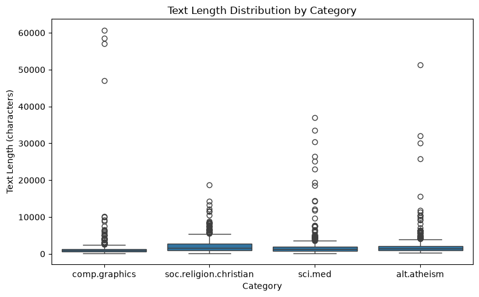
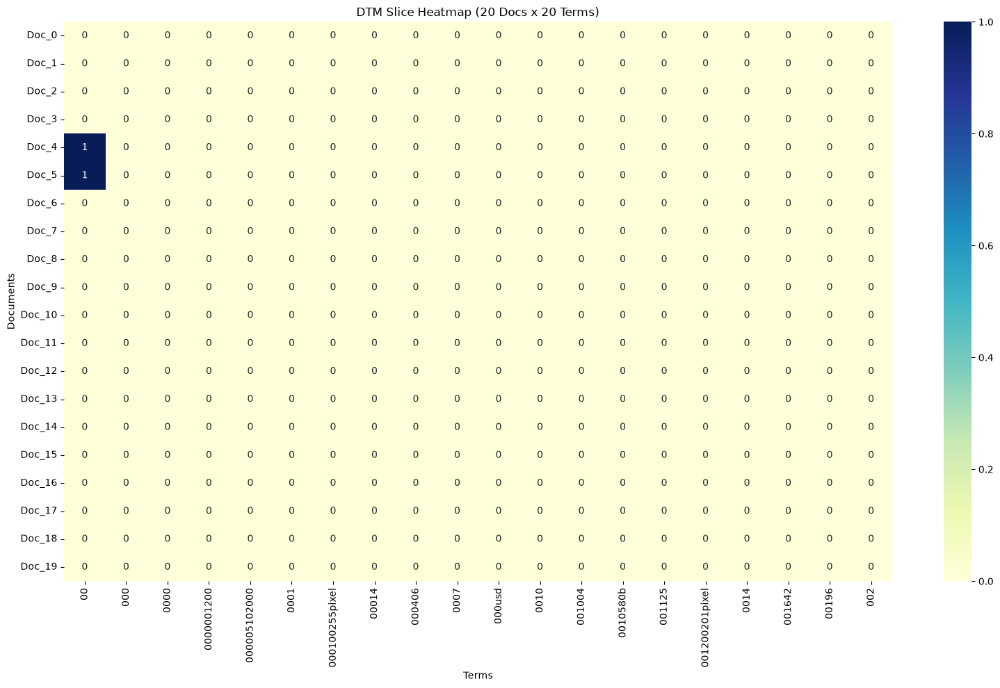
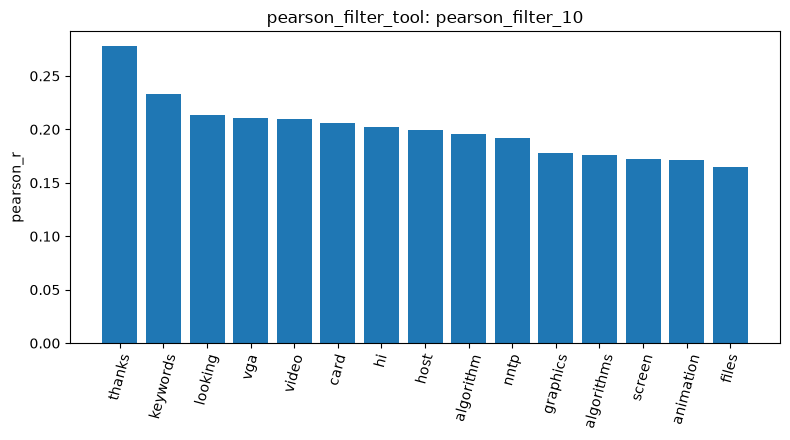
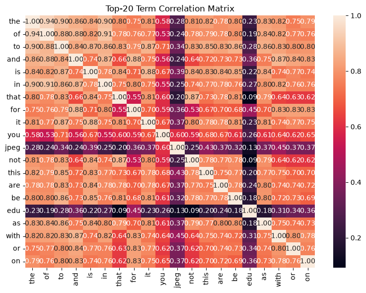
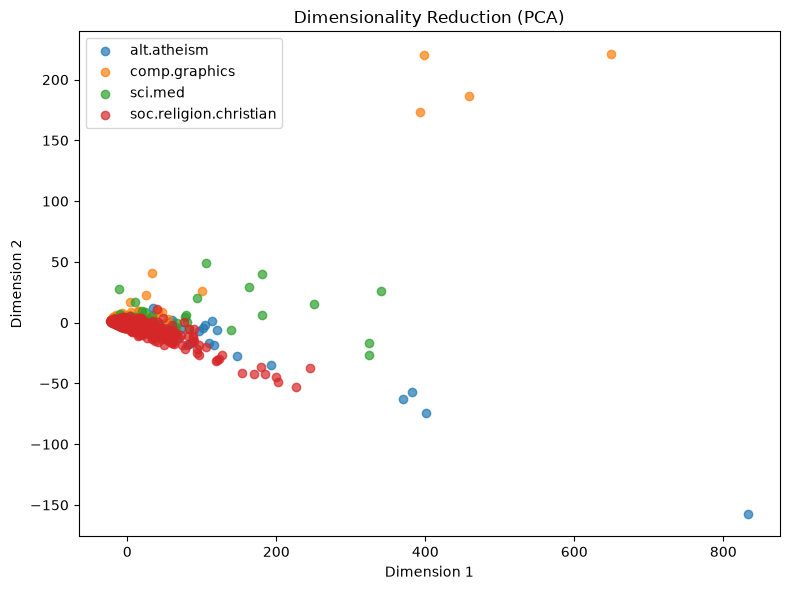

# Agentic Pipeline Report
All `result_id`s below are from the final run recorded in the session log.

1. About Data loading and quality
   - I loaded four 20 Newsgroups categories with `load_dataset_tool` (`load_dataset_1`), which combines 2,257 documents, namely 599 soc.religion.christian, 594 sci.med, 584 comp.graphics and 480 alt.atheism.
   - `inspect_data_2` shows three columns, the `text`, an integer `category`, and `category_name`, and the raw text starts with email headers.
   - `check_missing_3` found no missing text and `check_duplicates_4` found no duplicates, so no rows were dropped.
   - `describe_data_5` reports a mean length of 1,992.96 characters, a median of 1,235, a minimum of 125 and a maximum of 60,713, so the lengths are strongly right-skewed.
   - In the box plot comp.graphics has the shortest typical documents but also the longest outliers (roughly 47,000–60,000 characters), and every category has a long upper tail.
   - The figure is shown at .

2. About Document-term matrix
   - The `build_dtm_6` produced a 2,257 × 35,788 matrix with 365,886 non-zero entries, which means it has 99.547% sparsity.
   - `term_frequency_7` shows that the most frequent terms are these stop words: "the" (29,825), "of" (17,660), "to" (17,222), "and" (13,017) and "is" (12,343), and it is because this matrix keeps stop words.
   - The heatmap of a 20 × 20 slice (`dtm_heatmap_8`) has only two non-zero cells.
   - The slice covers the first, alphabetically sorted numeric tokens, so it mainly shows the matrix is very sparse.
   - The figure is shown at .

3. Filtering and correlation
   - `variance_filter_9` with threshold 0.01 kept 5,354 of 35,788 terms and removed 30,434 (about 85%), which means most terms are too rare to vary across documents.
   - `pearson_filter_10` correlated every term with the comp.graphics label. The strongest terms by absolute correlation were "thanks" (0.2778), "re" (−0.2566), "writes" (−0.2337), "keywords" (0.233) and "who" 
     (−0.2141), and these look like writing-style and header words rather than topic words: posts asking for help end with "thanks", while replies to others contain "re" and "writes".
   - The bar chart of the highest positive correlations (`visualize_result_tool` on `pearson_filter_10`) also contains genuine topic terms such as "vga", "video", "card", "algorithm", "graphics", "screen" and    
     "animation", but no single term exceeds a correlation of about 0.28.
   - The figure for the analysis above is shown at .
   - `feature_correlation_matrix_11` covers the 20 most frequent terms, and stop words are strongly correlated with each other (about 0.7–0.94, just like "the" and "of" at 0.94), while "jpeg" and "edu" correlate 
     weakly with the rest, and I think it is because the stop words rise and fall together with document length.
   - The figure for the analysis above is shown at .

4. Patterns, dimensionality reduction and similarity
   - `mine_patterns_tool` with FP-Growth on comp.graphics found 0 patterns at a minimum support of 58 documents (about 10%, `mine_patterns_12`) and 19 single-term patterns with support 18–22 at 18 documents (3%, 
     `mine_patterns_13`).
   - On alt.atheism at 14 documents (3%) the returned table has 828 single-term patterns with support 14–25 (`mine_patterns_18`); the agent's sentence said 395, which does not match the table, so that is why I 
     use the table.
   - The patterns are rare words such as "sea", "department" and "catholic", with no stop words or category keywords, and this is because it removes English stop words and keeps only terms between the 5th and    
     95th percentile of the chosen statistic, so the most frequent terms are removed.
   - `reduce_dimensions_14` (PCA, 2 components) explains 65.94% and 4.33% of the variance. In the plot below the four categories overlap almost completely and a handful of extreme points stretch the axes. I 
     think these are probably very long documents, since raw counts were used.
   - The figure for the analysis above is shown at .
   - `binarize_labels_15` gives 584 positive and 1,673 negative documents for comp.graphics.
   - The cosine similarity between documents 0 and 1 (both comp.graphics) is 0.3532 (`cosine_similarity_16`) and between documents 0 and 2 (comp.graphics vs soc.religion.christian) is 0.3399  
     (`cosine_similarity_17`). The same-category pair is slightly higher, but the gap is tiny and only one pair was tested, and shared stop words raise both values, so this is only illustrative.

5. The problem I faced and how I dealt with it
   - My first runs stalled because `variance_filter_tool` and the correlation tools returned all 35,788 terms to the agent, which exceeded the provider's per-minute token limit and exhausted every API key. 
   - I had the developer-stage agent fix this by returning only a truncated summary (the first 30 terms, or the top terms) while the full result stays stored under its `result_id`. I then re-ran the tests and 
     repeated the pipeline from the start.

