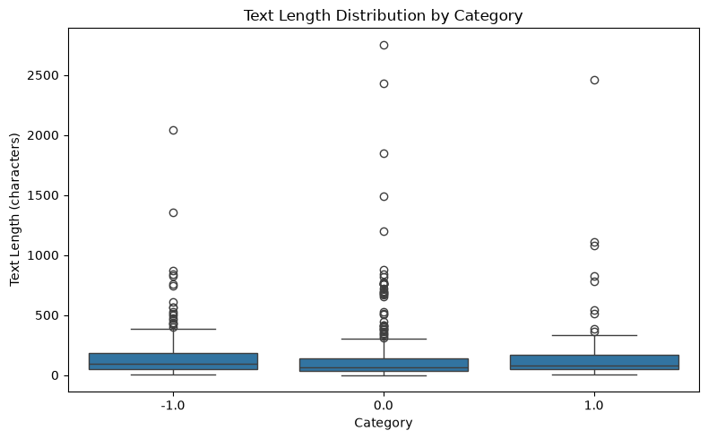
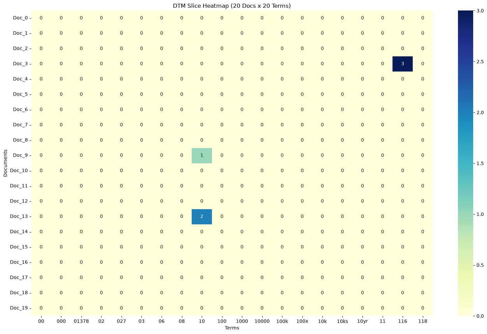
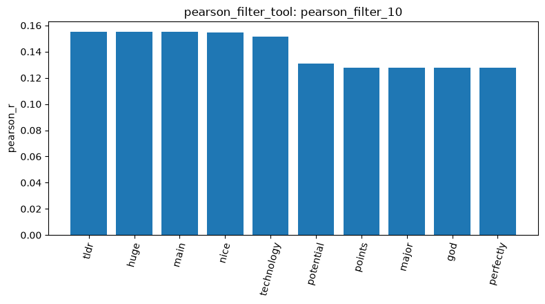
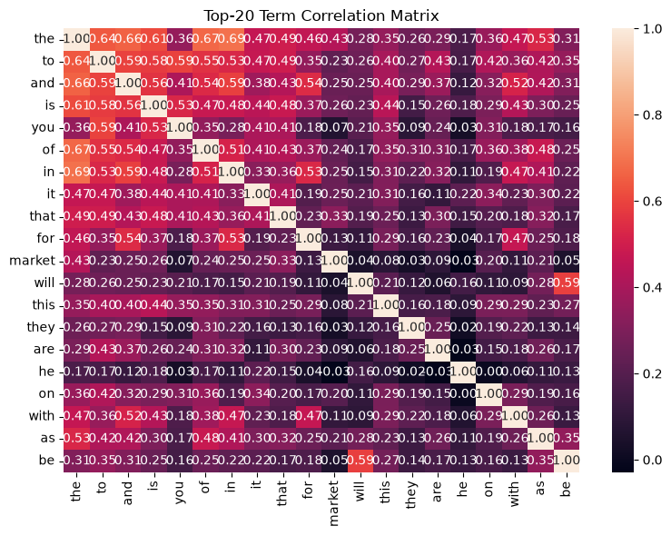
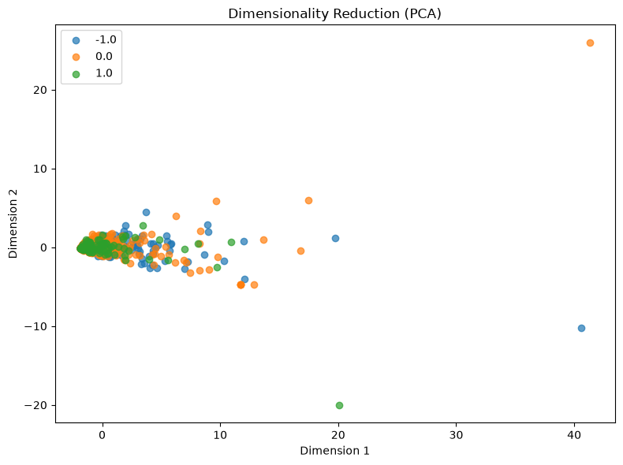

# Homework Report

1. Data loading and quality
   - `load_dataset_1` loaded 847 Reddit posts, which combine 423 labelled 0.0, 315 labelled -1.0 and 109 labelled 1.0.
   - `inspect_data_2` shows three columns (`text`, `category_name`, `category`) and very short texts. The first five rows are short and informal comments, like seeing lots of red in the ticker, and some of 
     them have nothing to do with stocks.
   - `check_missing_3` found no missing text.
   - `check_duplicates_4` found 23 duplicate rows but did not drop them (`Dropped: False`), so all later results use all 847 rows. I think it is because short replies on Reddit are often repetitive, for 
     instance, the same phrase might be posted by different users, or the same material might be reposted, whereas the long newsgroup emails had no duplicates.
   - `describe_data_5` reports a mean length of 148.68 characters, a median of 79, a minimum of 1 and a maximum of 2,753 (-1.0: mean 153.74, median 96; 0.0: mean 140.79, median 68; 1.0: mean 164.64, median 82).
     And I found that in the box plot the three classes look similar. The boxes are flat and close to zero, and every class has a long upper tail of outliers, with the longest posts at about 2,000–2,750 characters. Compared with the newsgroup posts, these posts are much shorter.
   - The figure is shown at .

2. About Document-term matrix
   - `build_dtm_6` produced an 847 x 4,346 matrix with 17,193 non-zero entries, which means it has 99.5329% sparsity.
   - `term_frequency_7` shows the most frequent terms are "the" (920), "to" (566), "and" (488), "is" (402) and "it" (350). These are all stop words, like articles, prepositions and pronouns, so they carry little 
     information about topic or sentiment, and I think they rank first because the matrix keeps stop words, as in the newsgroup run.
   - The heatmap of a 20 x 20 slice (`dtm_heatmap_8`) has only three non-zero cells (Doc_3 "116" = 3, Doc_9 "10" = 1, Doc_13 "10" = 2), so it mainly shows how sparse the matrix is.
   - The figure is shown at .

3. Filtering and correlation
   - `variance_filter_9` with threshold 0.01 kept 506 of 4,346 terms and removed 3,840.
   - `pearson_filter_10` correlated every term with class 1.0. The correlations are low: the maximum is 0.1551 ("tldr", "huge", "main"), then "nice" (0.1545) and "technology" (0.1514), and several terms share 
     exactly the same value.
   - I think the same values happen because these terms appear in only one or two posts, so they correlate with the label in the same way. Also I found that some top terms sound positive ("nice", "perfectly",
     "exciting"), but others ("tldr", "main", "3d") have no obvious link to sentiment, and no term is above 0.16, so no single word predicts positive posts well.
   - The bar chart of the top terms (`visualize_result_tool` on `pearson_filter_10`) is shown at .
   - `feature_correlation_matrix_11` covers 20 frequent terms: stop words correlate with each other ("the"–"in" 0.6943, "the"–"of" 0.6727, "the"–"and" 0.6623, "will"–"be" 0.5886), while "he"–"market" is about 0 (-0.
     0261).
   - I think the stop words are correlated because they all become more frequent in longer posts, and "will" and "be" probably often appear together as "will be". Also, "he" and "market" are almost uncorrelated, 
     since one is a pronoun and the other a topic word.
   - The figure is shown at .

4. Patterns, dimensionality reduction and similarity
   - `mine_patterns_12` (class 1.0, FP-Growth, minimum support 3 documents, term_frequency filtering, 971 terms kept) returned 51 patterns in the table, all with support 3–4; 50 are single terms and one has two 
     ("points", "main"; support 3).
   - The patterns are mostly ordinary words ("come", "went", "people"), a few finance words ("bank", "stock", "money", "invest") and a few evaluative words ("nice", "perfectly", "huge"), with no clear sentiment 
     theme. No stop words appear because, as I saw in the source code, `mine_patterns_tool` removes English stop words and drops the most frequent terms.
   - `reduce_dimensions_13` (PCA) explains 27.0% and 4.99% of the variance.
   - In the PCA plot the three classes overlap almost completely in one dense cluster, and a handful of extreme points stretch the axes. I think these may be very long posts because the raw counts were used.
   - The figure is shown at .
   - `binarize_labels_14` returned a three-column one-hot encoding of -1.0 / 0.0 / 1.0 (315 / 423 / 109) even though I asked about category 1.0. In the pipeline run the same tool was reported as a two-class split 
     for comp.graphics, while here the output has one column per sentiment class.
   - Cosine similarity was 0.0 for documents 0 and 1 (-1.0 vs 0.0, `cosine_similarity_15`), 0.2004 for documents 1 and 2 (0.0 vs 0.0, `cosine_similarity_16`) and 0.2491 for documents 2 and 3 (0.0 vs 1.0, 
     `cosine_similarity_17`).
   - Cosine similarity only measures shared words, not sentiment, and the matrix keeps stop words, so a pair can look similar just because both posts contain "the" or "in". The 0.0 for documents 0 and 1 simply 
     means they share no word.

5. Differences from 20 newsgroups
   - The posts are much shorter, mean about 149 vs 1,993 characters, so the vocabulary is only 4,346 terms instead of 35,788.
   - This dataset has 23 duplicate rows and three sentiment labels, whereas the newsgroup data had no duplicates and four topic categories.
   - The tools I ran worked without changes, but results such as the patterns and PCA were weak, probably because the texts are short and sparse.
